# mcd-host · 麦门东道主

[](https://github.com/jimpablo/mcd-host) [](https://github.com/jimpablo/mcd-host/blob/main/LICENSE) [](https://open.mcd.cn/mcp) [](https://github.com/jimpablo/mcd-host#30-%E7%A7%92%E8%AF%95%E7%8E%A9%E4%B8%8D%E9%9C%80-token) [](https://github.com/jimpablo/mcd-host)

**请客/团餐不知道点什么？告诉它人数、预算、忌口，它基于麦当劳中国 MCP 帮你凑一桌、挑最省的券、算人均，还能生成一张能直接发群的请客方案卡。**

`mcd-host` 把「请客点麦当劳」这件麻烦事变成三步：

```text
你：周六请 6 个同事吃饭，预算 300，有人不吃辣，看着安排。
mcd-host：麦辣鸡腿堡套餐×2 + 板烧鸡腿堡套餐×2 + 巨无霸套餐×2 + 共享小食甜品
          用「满100减20」省 ¥20，应付 ¥278，人均 ¥46.34，人均约 951 千卡。
          方案卡已生成，可以直接发群里。
```

它解决三件具体的事：

1. **选择困难**：菜单几十样，谁来决定？按人数、场合、预算自动凑一桌，套餐优先、小食甜品全桌共享；
2. **凑券心累**：实时拉取门店券和我的券，一单一张券的规则下挑最省的那张；差一点满减时会提醒「再加 ¥X 可用××省 ¥Y」；
3. **算账麻烦**：人均金额直接算好，忌口自动避开，热量超标有提醒。



## 30 秒试玩，无需 Token

装了 uv 的话，一行就能跑（合成数据，不会真的查门店、更不会下单）：

```bash
uvx --from git+https://github.com/jimpablo/mcd-host mcd-host demo
```

想多玩几步，装上它（Python 3.9+，零第三方依赖）：

```bash
uv tool install git+https://github.com/jimpablo/mcd-host
# 没有 uv：
pip install "git+https://github.com/jimpablo/mcd-host"

mcd-host demo --people 6 --budget 300            # 6 人晚饭，预算 ¥300
mcd-host demo --people 8 --budget 500 --avoid 辣 # 避开辣，庆生场
mcd-host demo --people 4 --occasion tea          # 下午茶场，不配甜品
mcd-host demo -o ~/Desktop/host.svg              # 顺便生成分享卡片
```

终端输出长这样：

```text
(demo 合成数据) 麦门东道主 · 请客参谋
门店：演示·东道主店
一桌菜（6 人 · 晚饭）

  麦辣鸡腿堡套餐（套餐）×2             ¥78.00
  板烧鸡腿堡套餐（套餐）×2             ¥79.00
  巨无霸套餐（套餐）×2                 ¥83.00
  玉米杯（小食）×3                     ¥27.00
  中薯条（小食）×1                     ¥11.50
  甜筒（甜品）×2                       ¥12.00
  菠萝派（甜品）×1                     ¥7.50

  小计：¥298.00
  优惠（满100减20）：-¥20.00
  应付：¥278.00
  人均：¥46.34
  人均约 951 千卡

分享卡片已写入：~/mcd-host-card-demo.svg
```

生成的分享卡片（自包含 SVG，浅色/深色自适应），两种样式随场合选：


`--style receipt` 是竖版热敏小票，带锯齿边和条形码，适合发朋友圈/小红书：


## 接入真实账户（3 步）

1. **申请 Token**：在 [麦当劳 MCP 开放平台](https://open.mcd.cn/mcp) 用手机号登录控制台，「激活」并复制 MCP Token。
2. **放在本机**：环境变量 `MCD_MCP_TOKEN`，或写进当前目录的 `.env`（`MCD_MCP_TOKEN=...` 或直接粘贴裸 Token 均可，已被 .gitignore 忽略），或写入 `~/.config/mcd-mcp/token`（`chmod 600`）。Token 只发给 `https://mcp.mcd.cn`，不会进日志、不会进仓库。
3. **拉数据、开点**：

```bash
mcd-host fetch stores --city 上海 --keyword 人民广场   # 查附近门店，拿门店编码
mcd-host fetch menu --store-code 012345 --out menu.json
mcd-host fetch coupons --store-code 012345 --out coupons.json
mcd-host fetch nutrition --out nutrition.json
mcd-host plan --people 6 --budget 300 --menu menu.json --coupons coupons.json \
    --nutrition nutrition.json --store "人民广场店" --card -o ~/Desktop/host.svg
```

真实数据跑一遍长这样（上海人民广场某店，6 人晚饭预算 ¥300）：

```text
门店：麦当劳上海黄浦华旭国际大厦餐厅｜菜单 115 项｜券 7 张｜营养 158 条
一桌菜（6 人 · 晚饭）

  酥脆无双套餐（套餐）×2               ¥40.00
  "辣"么快乐套餐（套餐）×2             ¥48.00
  麦乐鸡套餐（套餐）×2                 ¥50.00
  蘸酱炸鸡（小食）×2                   ¥23.80
  蘸酱麦麦脆汁鸡（小食）×1             ¥11.90
  玉米杯（小食）×1                     ¥13.00
  薯条（小食）×2                       ¥27.00
  圆筒冰淇淋（甜品）×2                 ¥10.00
  派（甜品）×1                          ¥8.50

  小计：¥232.20
  优惠（中薯条买一送一）：-¥13.50
  应付：¥218.70
  人均：¥36.45
```

`plan` 也支持一次给全：把所有数据写进一个 JSON（`{"request": {...}, "menu": {...}, "coupons": {...}, "nutrition": {...}}`），用 `--input` 传入——这是 Agent 的推荐用法。

**贴到 GitHub 个人主页**（全程在本机手动完成）：

1. 建一个和用户名同名的仓库 `<用户名>/<用户名>`，GitHub 会把它的 README 显示在你的个人主页上；
2. 在本机运行 `mcd-host plan … --card -o <那个仓库的目录>/host-card.svg`（或 `--style receipt` 生成小票版）；
3. 在那个仓库的 README.md 里加一行 ``；
4. 自己 `git add`、`git commit`、`git push`。

**不要用 GitHub Actions 定时生成。** MCP Token 不能放进 CI（服务规则不允许把凭证托管到第三方平台），也不允许自动化调用。想更新就在本机再跑一次。

10-24 程序员节当天生成的卡片会带 「Happy 0x400 Day」 彩蛋标语。

## 交给你的 Agent

[mcd-host](https://github.com/jimpablo/mcd-host) 同时是一个 **Agent Skill**。把下面这段话原样发给 WorkBuddy / Claude Code / Kiro（Agent 需要能在本机执行命令）：

```text
请帮我安装 mcd-host 这个麦当劳请客参谋 Skill：
1. 运行 uv tool install git+https://github.com/jimpablo/mcd-host（没有 uv 就用 pip install "git+https://github.com/jimpablo/mcd-host"），然后运行 mcd-host demo 确认装好了；
2. 把 https://github.com/jimpablo/mcd-host 仓库根目录的 SKILL.md 装进你的 Skill 目录；
3. 以后我说要请客/团餐/聚餐点麦当劳，就按 SKILL.md 用 mcd-host --json 操作。涉及真实下单必须先给我看确认摘要，我明确同意后才能继续。
Token 我会自己配置（环境变量 MCD_MCP_TOKEN 或 .env），不用在对话里发给你。没有 Token 时先用 --demo 给我演示。
```

之后你就可以直接说大白话：

```text
你：   周五团建 12 人，预算 600，两个减脂期别太高热量，安排一下。
Agent：（fetch stores → fetch menu/coupons/nutrition → mcd-host plan --input ... --json）
       12 人团餐，四种套餐轮换 + 小食甜品，用「满200减30」省 ¥30，
       应付 ¥568，人均 ¥47.34，人均约 880 千卡（减脂的同事可以少分一份薯条）。
       要生成方案卡发群里吗？
```

**和普通 Skill 的区别**：mcd-host 本体**只读**。查菜单、查券、算价格都是只读工具；真正的写操作（`create-order` 等）不在 mcd-host 的工具白名单里，由 Agent 在 MCP 客户端中调用，并且必须先给你看确认摘要、你同意后才执行——和 Skill 里的规则一起，保证「先看方案，再下单」。

## 命令一览

| 命令 | 作用 | 会改动账户吗 |
|---|---|---|
| `plan` | 凑一桌：套餐优先、预算控制、忌口过滤、挑最省的券、算人均和热量 | 否 |
| `card` | 由方案生成分享卡片 SVG（`--style card` 方案卡 / `receipt` 请客小票） | 否 |
| `demo` | 合成数据一键演示，不需要 Token | 否 |
| `fetch stores/menu/coupons/nutrition` | 用 MCP Token 拉取只读数据 | 否 |

常用参数：`--people` 人数、`--budget` 总预算（元）、`--occasion` 场合（lunch/dinner/tea/breakfast/birthday/team）、`--avoid` 忌口、`--prefer` 偏好、`--must` 必点 code、`--max-cal` 人均热量上限、`--with-dessert/--no-dessert` 甜品开关、`--style` 卡片样式、`--store/--host/--date` 卡片信息、`--card`/`-o` 生成卡片。所有命令支持 `--json`（给 Agent 和脚本用）。

`mcd-host help` 看对照表；`mcd-host plan -h` 看单个命令的参数。

## 凑桌逻辑（可解释、可复现）

1. **套餐优先**：门店有套餐时每人一份，最多 3 种轮换，通常比单点划算；低于 ¥20 的单人随心配（如 1+1）不算请客正餐；
2. **单点兜底**：没有合适套餐时，主食/饮料按人分配，小食全桌共享（每 2 人一份），甜品看场合（晚饭/下午茶/庆生/团餐才配，每 3 人一份）；
3. **预算优先**：核心（主食/饮料）必须满足，其次小食，最后甜品；人均预算内没有合适套餐时按最低价配置并提醒；超预算时不加共享项；
4. **不加东西**：只在菜单已有品类里选，绝不为了凑数多加品类；
5. **一单一张券**：MCP 规则一单只能用一张券。支持三种券——满减券（满 X 减 Y）、商品券（用券价格）、买一送一券；选品时按**券后有效价**排序（有「中薯条买一送一」时会自动偏向薯条），最后精确计算省多少，挑最省的；够不到满减门槛时提示还差多少，买一送一只买了 1 份时提示加到 2 份；
6. **分摊与热量**：人均应付向上取整到分；营养名和菜单名有规格差异时模糊匹配（「玉米杯」↔「大杯玉米杯」），营养表覆盖不全时明说「人均热量是下限」；
7. **不加东西**：只在菜单已有品类里选，绝不为了凑数多加品类。

## 数据与隐私

- mcd-host 只调用白名单内的**只读** MCP 工具：`query-nearby-stores`、`query-meals`、`query-meal-detail`、`query-store-coupons`、`query-my-coupons`、`available-coupons`、`list-nutrition-foods`、`campaign-calendar`、`now-time-info`。写操作（下单、取消、领券、积分兑换、抽奖）**一律不调用**，也不在代码里实现；
- MCP 地址 `https://mcp.mcd.cn` 写死在代码里，Token 只从本机环境变量 / `.env` / 配置文件读取，只进请求头，不打印、不写日志、不进仓库；
- 生成的卡片只有菜品、份数、金额、人数和门店名，没有手机号、订单号、地址；
- 价格、库存、券的有效性以麦当劳下单时的实时结果为准，本工具的输出仅供请客参考。

## 目标用户

- **请客/团餐/团建的组织者**：不想在菜单前纠结半小时，也不想算错账；
- **想让 Agent 代点餐、但每一步都要看得见管得住的人**：方案先看再下，写操作永远在自己确认之后；
- **对热量/预算有要求的人**：减脂期请客也能安排好。

## 路线图

- **P1**：历史方案本地记录，常吃的搭配一键复用；多人忌口逐人标注；
- **P2**：得来速/麦乐送场景的地址与配送费纳入方案。

欢迎提 Issue 和 PR。新命令请保持「只读命令零副作用、写操作一律不碰」这条规矩。

## 更多文档

- [MCP_INTEGRATION.md](MCP_INTEGRATION.md)：用到的 MCP 工具、命令与工具的对应关系、调用时序、业务价值与写操作边界
- [SKILL.md](SKILL.md)：给 Agent（WorkBuddy / Claude Code / Kiro）的使用说明
- [CONTEST_DECLARATION.md](CONTEST_DECLARATION.md)：参赛声明（麦当劳程序员节创意开发大赛）

## 声明

- 本项目是麦当劳程序员节创意开发大赛的参赛作品，由参赛者独立开发，非麦当劳官方产品；
- 项目输出仅供参考，不构成医疗、营养或其他专业建议；餐品信息、价格及供应状态以麦当劳官方渠道的实时结果为准；
- 仓库中不使用麦当劳的 Logo、IP 形象或官方图片；演示数据全部为合成数据。代码以 [MIT](LICENSE) 协议开源。
